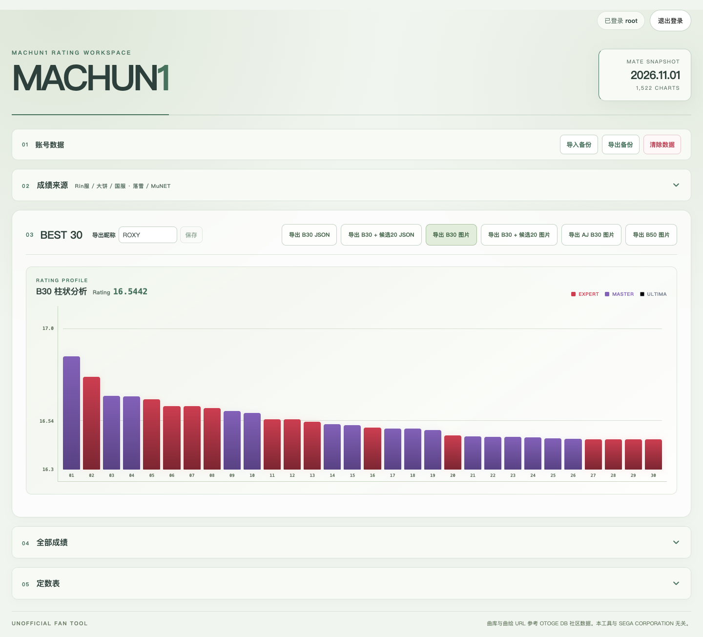
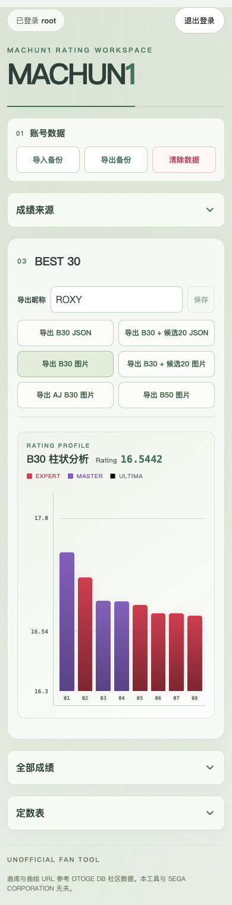
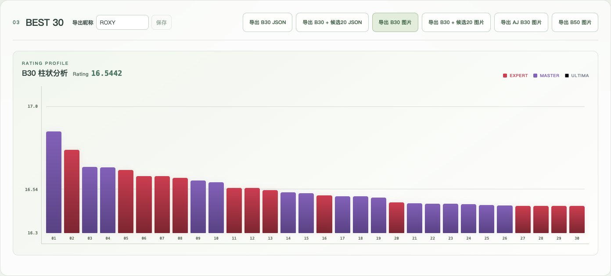
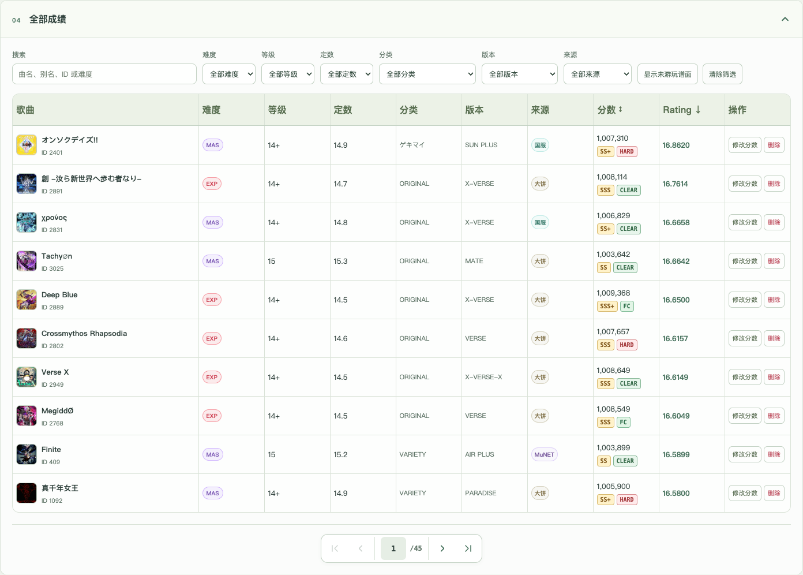
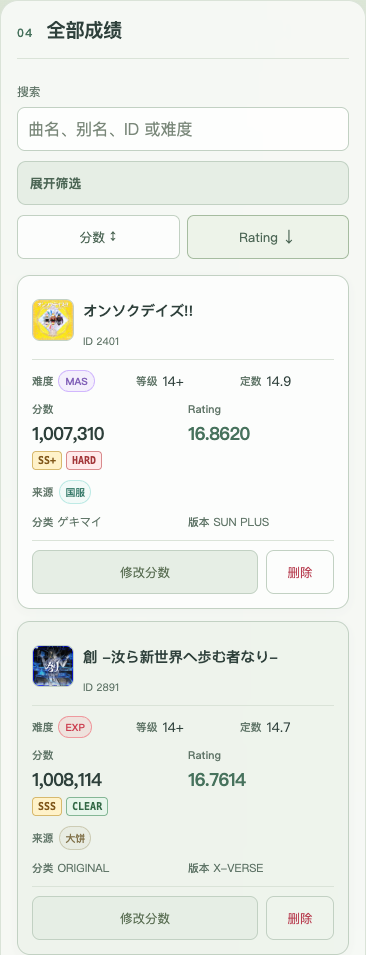
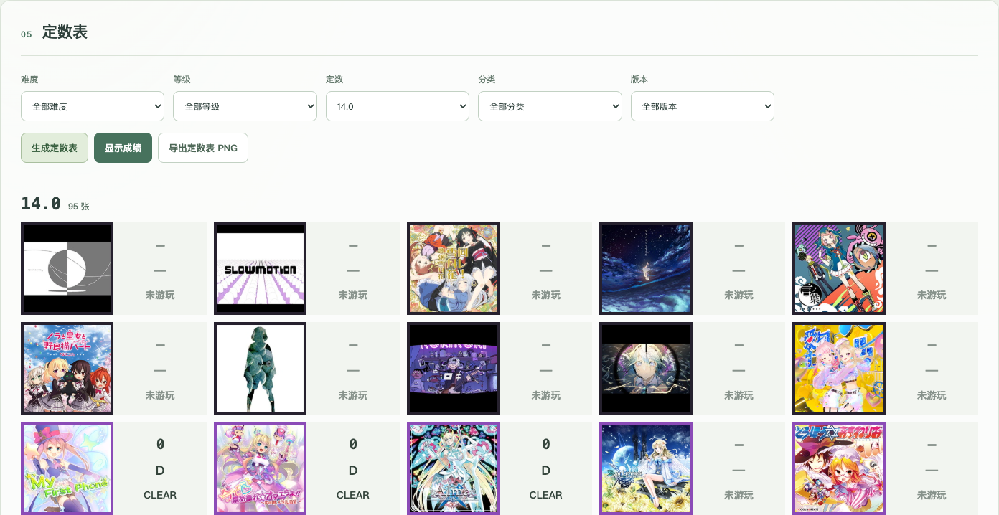
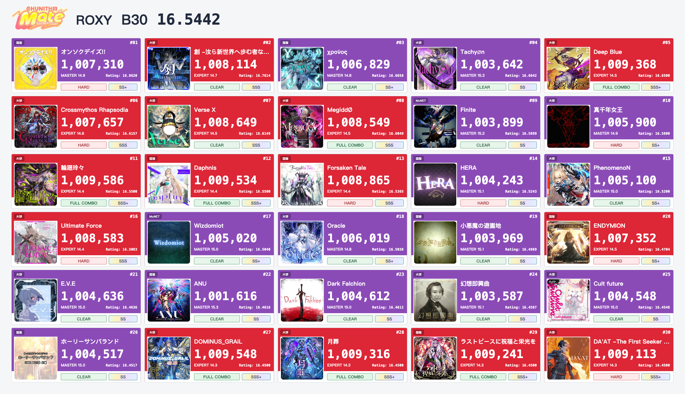

<div align="center">

# MACHUN1

**把四个来源的 CHUNITHM 成绩，放进同一个工作区。**

同步最高分 · 查看 Rating · 筛选曲库 · 导出分表

[线上看板](http://124.221.227.122:1650) · [项目预览](#preview) · [快速开始](#quick-start) · [使用指南](docs/usage.md)


[](LICENSE)

</div>

<a id="preview"></a>

## 当前看板



<details>
<summary>查看手机完整页面</summary>



</details>

<details>
<summary>查看 BEST 30 看板近景</summary>



</details>

| 已保存成绩 | B30 Rating | 评分曲库 | 成绩来源 |
| :---: | :---: | :---: | :---: |
| **446** 张谱面 | **16.5442** | **1,522** 张 13.0+ 谱面 | **4** 个 |

截图和统计采集于 **2026-11-03 17:27（UTC+8）**，直接来自服务器上的实际工作区，为静态快照。曲库为 **2026-11-01 MATE** 快照，包含 **1,255** 首歌曲，支持 EXP / MAS / ULT。[查看采集记录](docs/previews/metadata.json)。线上看板需要登录，网页暂不提供注册。

## 从来源同步到成绩导出

| 连接来源 | 汇总成绩 | 浏览与分析 | 分享与保存 |
| --- | --- | --- | --- |
| MuNET、Rin、大饼、国服落雪 | 同谱面合并最高分 | B30 柱状图与 Rating | B30 / AJ B30 / B50 PNG |
| 门户登录或个人 API Token | 保留 FC / AJ / AJC 等标记 | 曲库筛选、歌曲详情与别名 | B30 + 候选20、定数表 |
| 支持成绩文件导入 | MySQL 按网页账号隔离 | 分数或 Rating 单项排序 | JSON 与完整成绩备份 |

本机运行可打开专用浏览器绑定。部署到服务器后，在电脑运行登录助手完成门户登录，之后可直接用手机触发同步。同步由用户主动发起。[绑定与同步](docs/usage.md#sync)。

## 电脑与手机，共用一份成绩

<table>
  <tr>
    <th width="74%">电脑：筛选、排序与表格浏览</th>
    <th width="26%">手机：卡片浏览</th>
  </tr>
  <tr>
    <td valign="top"></td>
    <td valign="top"></td>
  </tr>
</table>

「全部成绩」默认收起，展开后可搜索曲名、别名或 ID，按难度、等级、定数、分类、版本和来源筛选，也可查看未游玩谱面。每页 10 项；分数与 Rating 只能选择一项排序，同值时比较另一项，升降方向一致。点击曲名打开详情，并管理自己的个人别名。

## 定数表：选等级，查看全部定数



「定数表」默认收起，展开后可选择具体定数；选定一个等级后，也可选择该等级的「全部定数」，「全部等级」下禁用此选项。选项随难度、分类和版本联动，曲库不存在的定数不会出现。生成后可切换纯封面或成绩视图并导出 PNG，手机自动调整列数；两区收起后保留筛选和已生成结果。

## 导出结果，直接预览

以下是服务器当前成绩实际生成的 **B30 PNG**，昵称为 **ROXY**。



| 导出 | 内容 |
| --- | --- |
| B30 / AJ B30 | 最高 30 张，或仅包含 AJ / AJC 的前 30 张 |
| B30 + 候选20 | 最佳 30 张与后续 20 张候选谱面 |
| B50 | OLD 30 + MATE NEW 20，各区独立排名 |
| 定数表 | 封面视图或成绩视图 |
| JSON / 完整备份 | OTO 成绩格式，或全部成绩、来源、标记与个人别名 |

B30 平均固定除以 30，空位按零计；B50 固定除以 50，仅统计当前评分曲库。这里的 Rating 不含 Recent 等其他游戏总 Rating 项。图片先预览，再保存；完整备份不含来源绑定凭据，导入时替换当前账号的全部成绩和个人别名，导出昵称另行保存。[详细规则](docs/usage.md#records)。

<a id="quick-start"></a>

## 快速开始

### 本机运行

需要 **Node.js 24.x、pnpm 10.15.0、MySQL 8.4**。已验收的桌面环境为 macOS。

```bash
git clone https://github.com/MAK1MAAaa/MACHUN1.git
cd MACHUN1
corepack enable
corepack prepare pnpm@10.15.0 --activate
pnpm install --frozen-lockfile
pnpm browser:install
```

按[本机运行指南](docs/local.md)初始化数据库并执行全部四项迁移，使用仅有 CRUD 权限的应用账号，将连接配置写入被 Git 忽略的 `.env`，然后启动：

```bash
chmod 600 .env
pnpm db:catalog
pnpm start
```

打开 [http://127.0.0.1:4399](http://127.0.0.1:4399)，使用部署管理员提供的账号登录。数据库迁移由管理员执行，应用启动不会自动修改表结构。停止服务按 Ctrl+C，已保存的数据保留。

### Docker / 1Panel

容器架构为 **linux/amd64**，默认端口 **1650**，数据卷挂载 `/data`。编排使用已有的 `1panel-network` 和 MySQL，部署前需调整数据库连接并完成迁移。

| 路径 | 入口 |
| --- | --- |
| 从当前源码构建、生成离线部署包 | [Docker / 1Panel 指南](docs/1panel.md) · `pnpm docker:package` |
| 使用已发布的 Hub 镜像 | [Docker Hub](https://hub.docker.com/r/mak1maaaa/machun1) · [compose.hub.yaml](compose.hub.yaml) |
| 电脑完成服务器来源绑定 | [登录助手](docs/1panel.md#电脑绑定手机同步) |

线上示例从 `main` 构建，Hub 镜像单独发布。更新时保留原 Compose 项目名、数据库和数据卷；使用 `compose.runtime.json` 的实例按部署记录中的双文件命令操作。

## 开发与文档

```bash
pnpm dev       # 网页 4399，API 4398
pnpm test
pnpm build
```

`pnpm test` 默认跳过 MySQL 集成用例。运行 `pnpm test:mysql` 需安装 Docker 和 Google Chrome，测试使用独立数据库，不读取项目 `.env` 或访问正式库。

| 文档 | 内容 |
| --- | --- |
| [使用与开发指南](docs/usage.md) | 同步、合并规则、Rating、导出、备份、命令与常见问题 |
| [本机运行](docs/local.md) | 数据库准备、本地启动与 SSH 隧道 |
| [Docker / 1Panel](docs/1panel.md) | 编排、登录助手、更新与故障处理 |
| [曲库来源](src/data/catalog-sources.json) | 曲库快照、定数补充、别名和日期来源 |
| [预览采集记录](docs/previews/metadata.json) | 服务器版本、采集时间、真实统计与图片尺寸 |

技术栈：React + TypeScript + Vite；Node.js + mysql2 + Drizzle；MySQL 保存共享曲库、账号工作区与来源状态。

## 许可证与素材

代码采用 [Apache License 2.0](LICENSE)。本项目与 SEGA CORPORATION 及上述成绩服务无隶属关系。CHUNITHM 商标、曲绘、歌曲及外部曲库、别名素材归各自权利人所有；预览截图与导出样例中的素材亦遵循其原有权利归属。素材与数据来源见[使用指南](docs/usage.md#许可证与素材)和[内置 Logo 说明](src/assets/README.md)。
