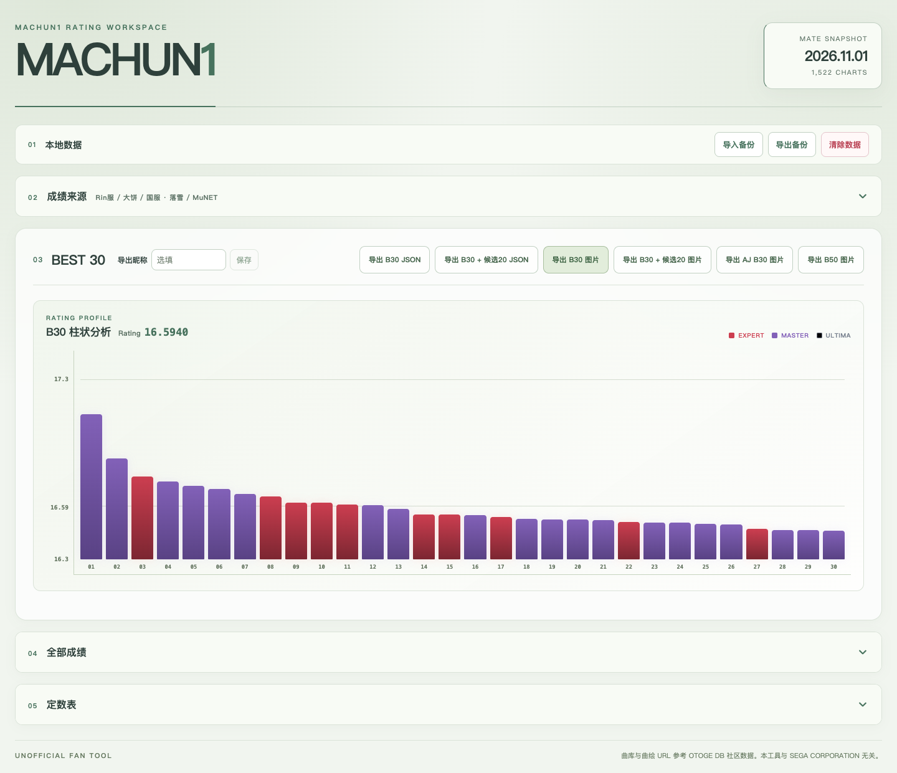
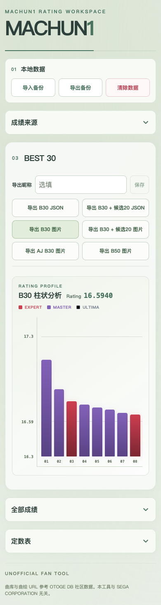
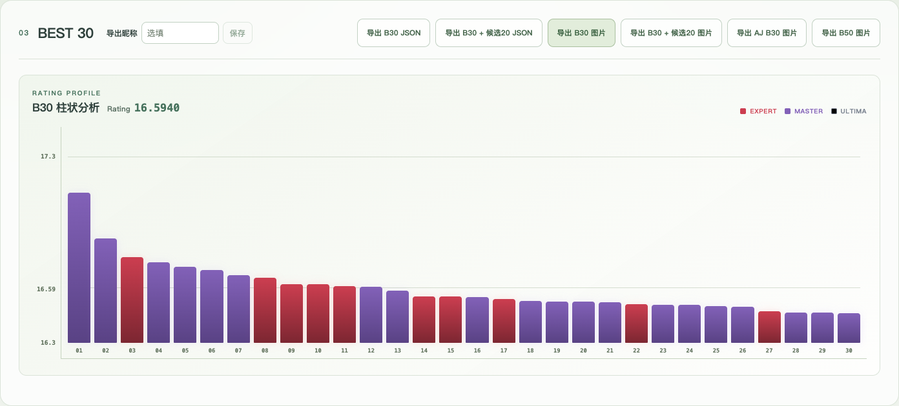
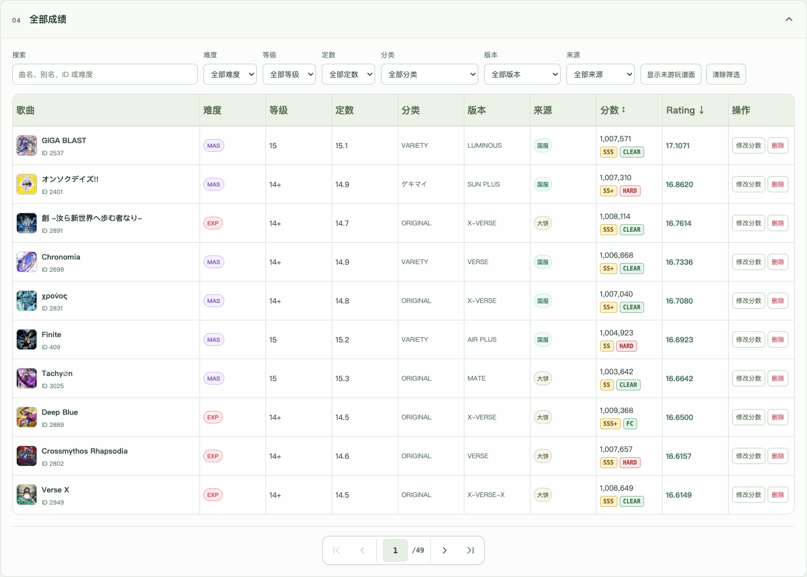
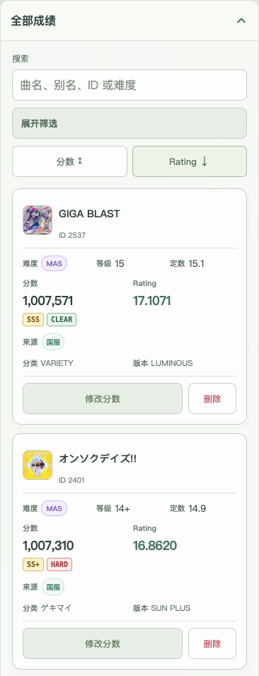
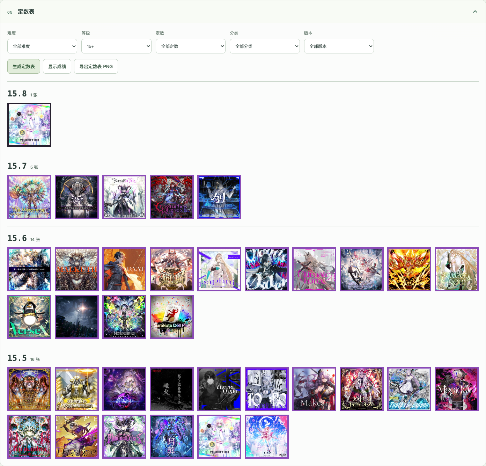
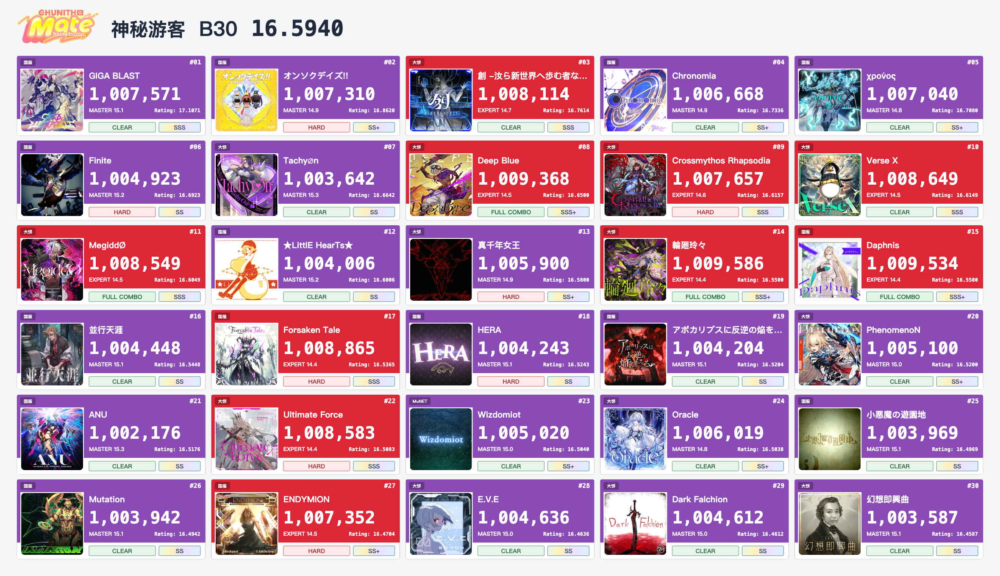

<div align="center">

# MACHUN1

**在本机汇总四个来源的 CHUNITHM 成绩，打开工作台即可使用。**

同步最高分 · 查看 Rating · 筛选曲库 · 导出分表

[项目预览](#preview) · [快速开始](#quick-start) · [使用指南](docs/usage.md)


[](LICENSE)

</div>

<a id="preview"></a>

## 界面预览

以下截图采集于 **2026-11-23**，使用已从备份导入的本地 SQLite 成绩。



<details>
<summary>查看手机完整页面</summary>



</details>

<details>
<summary>查看 BEST 30 看板近景</summary>



</details>

| 已保存成绩 | B30 Rating | 评分曲库 | 支持的成绩来源 |
| :---: | :---: | :---: | :---: |
| **482** 张谱面 | **16.5940** | **1,522** 张 13.0+ 谱面 | **4** 个 |

曲库预览使用 **2026-11-01 MATE** 快照，包含 **1,255** 首歌曲，支持 EXP / MAS / ULT。[查看截图采集记录](docs/previews/metadata.json)。

## 从来源同步到成绩导出

| 连接来源 | 汇总成绩 | 浏览与分析 | 分享与保存 |
| --- | --- | --- | --- |
| MuNET、Rin、大饼、国服落雪 | 同谱面合并最高分 | B30 柱状图与 Rating | B30 / AJ B30 / B50 PNG |
| 门户登录或个人 API Token | 保留 FC / AJ / AJC 等标记 | 曲库筛选、歌曲详情与别名 | B30 + 候选20、定数表 |
| 支持成绩文件导入 | SQLite 保存本地数据 | 分数或 Rating 单项排序 | JSON 与完整成绩备份 |

- **OTO（大饼）、Rin、MuNET**。首次绑定时，在弹出的专用浏览器完成门户登录和必要的验证码。工作台自动识别身份并保存会话，后续点击「同步成绩」即可复用。会话失效时，可在对应来源重新登录。
- **国服 · 落雪**。在「成绩来源」中填写个人 API Token，绑定后即可同步。[绑定与同步](docs/usage.md#sync)

## 桌面与窄屏布局

<table>
  <tr>
    <th width="74%">电脑：筛选、排序与表格浏览</th>
    <th width="26%">窄屏：卡片浏览</th>
  </tr>
  <tr>
    <td valign="top"></td>
    <td valign="top"></td>
  </tr>
</table>

「全部成绩」默认收起，展开后可搜索曲名、别名或 ID，按难度、等级、定数、分类、版本和来源筛选，也可查看未游玩谱面。每页 10 项；分数与 Rating 只能选择一项排序，同值时比较另一项，升降方向一致。点击曲名打开详情，并管理自己的个人别名。

## 定数表：选等级，查看全部定数



「定数表」默认收起，展开后可选择具体定数；选定一个等级后，也可选择该等级的「全部定数」，「全部等级」下禁用此选项。选项随难度、分类和版本联动，曲库不存在的定数不会出现。生成后可切换纯封面或成绩视图并导出 PNG，手机自动调整列数；两区收起后保留筛选和已生成结果。

## 导出结果，直接预览

以下是从本地工作台导出的 **B30 PNG**。



| 导出 | 内容 |
| --- | --- |
| B30 / AJ B30 | 最高 30 张，或仅包含 AJ / AJC 的前 30 张 |
| B30 + 候选20 | 最佳 30 张与后续 20 张候选谱面 |
| B50 | OLD 30 + MATE NEW 20，各区独立排名 |
| 定数表 | 封面视图或成绩视图 |
| JSON / 完整备份 | OTO 成绩格式，或全部成绩、来源、标记与个人别名 |

B30 平均固定除以 30，空位按零计；B50 固定除以 50，仅统计当前评分曲库。这里的 Rating 不含 Recent 等其他游戏总 Rating 项。图片先预览，再保存；完整备份不含来源绑定凭据，导入时替换本地工作台的全部成绩和个人别名，导出昵称另行保存。[详细规则](docs/usage.md#records)。

<a id="quick-start"></a>

## 快速开始

### 本机运行

使用 **Node.js 24.x** 和 **pnpm 10.15.0**。

```bash
git clone https://github.com/MAK1MAAaa/MACHUN1.git
cd MACHUN1
pnpm install --frozen-lockfile
pnpm browser:install
pnpm start
```

打开本机地址即可进入免登录工作台。服务只监听本机回环地址，按 **Ctrl+C** 可停止。[打开本地工作台](http://127.0.0.1:4399/)

### 本地数据与旧版恢复

首次启动会自动创建 `.machun.local/machun1.sqlite`，用于保存成绩、个人别名、导出昵称和来源会话。曲库随项目提供。

从旧 MySQL 工作区迁移时，先在旧版导出完整备份，再在本地工作台的「本地数据」中导入。来源需在本机重新绑定。早期保存在浏览器中的成绩和别名，可在原浏览器与原本机地址下自动迁移。[本机运行与数据恢复](docs/local.md#restore-data)

## 开发与文档

```bash
pnpm dev       # 网页 4399，API 4398
pnpm test
pnpm build
```

`pnpm test` 包含 SQLite 集成测试。安装 Chromium 后运行 `pnpm test:browser`，可验证本地工作台及模拟门户会话。

| 文档 | 内容 |
| --- | --- |
| [使用与开发指南](docs/usage.md) | 同步、合并规则、Rating、导出、备份、命令与常见问题 |
| [本机运行](docs/local.md) | 启动、数据存放与旧成绩恢复 |
| [曲库来源](src/data/catalog-sources.json) | 曲库快照、定数补充、别名和日期来源 |
| [预览采集记录](docs/previews/metadata.json) | 本地工作台的采集时间、成绩汇总和图片校验值 |

界面使用 React、TypeScript 和 Vite。Node.js 服务通过内置 SQLite 保存本地工作台和来源状态。

## 许可证与素材

代码采用 [Apache License 2.0](LICENSE)。本项目与 SEGA CORPORATION 及上述成绩服务无隶属关系。CHUNITHM 商标、曲绘、歌曲及外部曲库、别名素材归各自权利人所有；预览截图与导出样例中的素材亦遵循其原有权利归属。素材与数据来源见[使用指南](docs/usage.md#许可证与素材)和[内置 Logo 说明](src/assets/README.md)。
