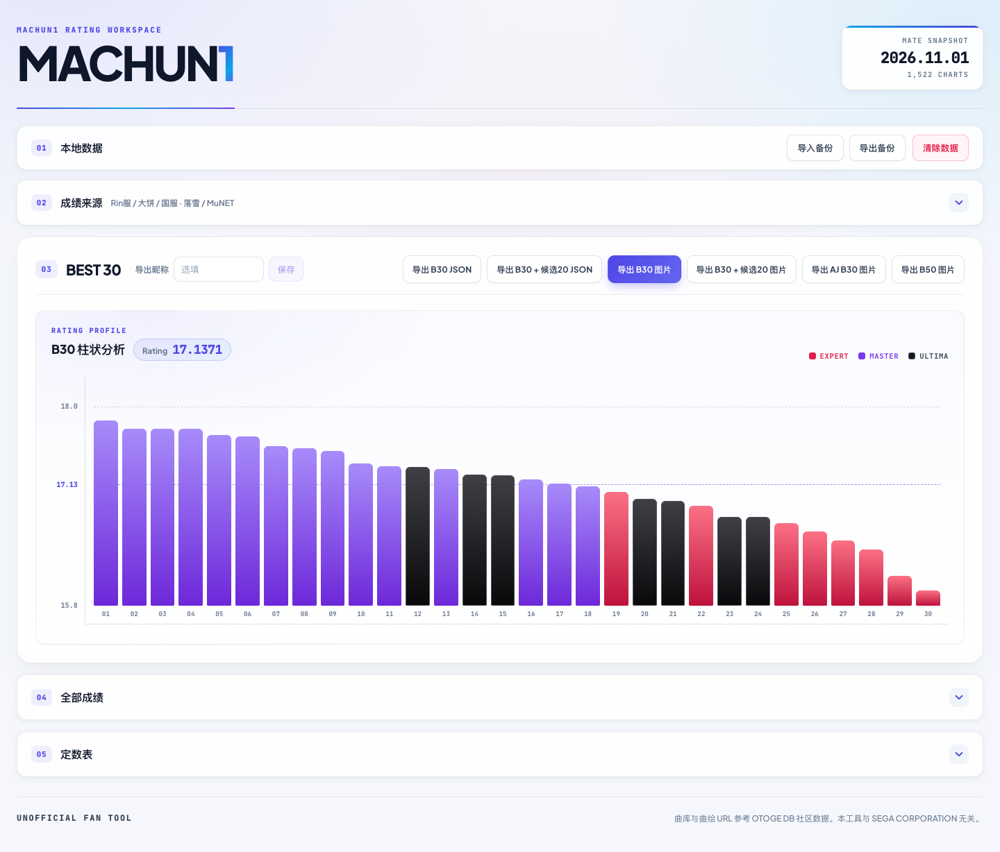
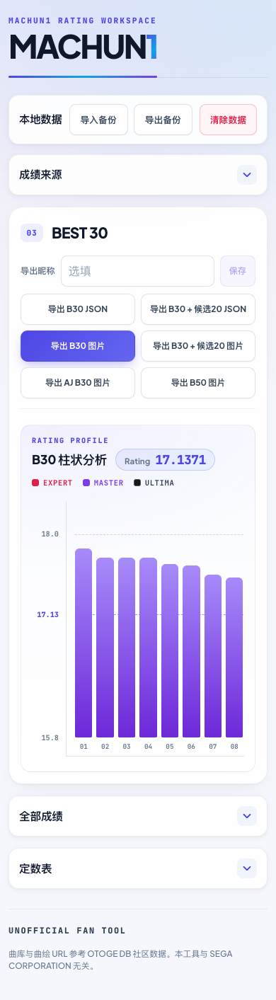

# MACHUN1

MACHUN1 是一个在本机运行的 CHUNITHM 成绩工作台。你可以从 MuNET、Rin、OTO（大饼）和国服落雪同步或导入成绩，按谱面汇总最高分，查看 B30 Rating，并导出分表和定数表。

[快速开始](#quick-start) · [使用指南](docs/usage.md) · [本机配置与数据恢复](docs/local.md)

<a id="preview"></a>

## 工作台预览



预览使用演示成绩。桌面以表格浏览全部成绩，手机以卡片显示分数、Rating 和达成状态。

<details>
<summary>查看手机工作台</summary>



</details>

<a id="quick-start"></a>

## 快速开始

准备 **Node.js 24.x** 和 **pnpm 10.15.0**，在终端安装并启动工作台。

```bash
git clone https://github.com/MAK1MAAaa/MACHUN1.git
cd MACHUN1
pnpm install --frozen-lockfile
pnpm browser:install
pnpm start
```

打开 [本机工作台](http://127.0.0.1:4399/)。服务仅监听本机回环地址，按 **Ctrl+C** 停止。Chromium 用于在专用浏览器中登录成绩来源。

## 同步与导入

在工作台展开「成绩来源」，按对应来源绑定账号，再点击「同步成绩」。已有成绩文件时，也可以直接通过对应的来源卡片导入。

| 来源 | 绑定方式 | 文件导入 |
| --- | --- | --- |
| MuNET | 在专用浏览器登录门户 | 存档 JSON |
| Rin | 在专用浏览器登录门户并选定 Aime 卡 | 存档 JSON |
| OTO（大饼） | 在专用浏览器登录门户并绑定当前主卡 | `oto.json` |
| 国服落雪 | 填写个人 API Token | 成绩 CSV 或个人成绩 JSON |

同步与导入覆盖内置 13.0+ 评分曲库中的 EXP、MAS 和 ULT 谱面。工作台按谱面保存最高分，并记录来源提供的 CLEAR、FC、AJ、AJC 等状态。单个导入文件最大 10 MB。[查看绑定和合并规则](docs/usage.md#sync)

## 浏览与导出

- **BEST 30** 展示最佳 30 张谱面的单曲 Rating 和平均 Rating，空位按零计入平均值。
- **全部成绩** 支持按曲名、别名或 ID 搜索，并按谱面条件筛选。打开歌曲详情可查看谱面资料和编辑个人别名。
- **定数表** 可查看指定定数或某等级内的全部定数。封面模式用于浏览曲绘，成绩模式将分数与评级、达成状态分行显示。

| 导出 | 内容 |
| --- | --- |
| B30 / AJ B30 PNG | 最佳 30 张谱面，或仅统计 AJ / AJC 的最佳 30 张 |
| B30 + 候选 20 | 最佳 30 张及后续 20 张，可导出 PNG 或 OTO 格式 JSON |
| B50 PNG | 旧曲 30 张与 MATE 新曲 20 张，分区统计 |
| 定数表 PNG | 按定数与难度分组的封面或成绩表 |
| B30 JSON | OTO 格式的最佳 30 条成绩 |
| 完整备份 JSON | 全部成绩、来源、达成状态和个人别名 |

[查看 Rating、导出与导入规则](docs/usage.md#records)

## 本地数据

首次启动会在 `.machun.local/` 创建 SQLite 数据库。成绩、个人别名、导出昵称和来源会话都保存在该数据目录。端口和数据目录可分别通过 `MACHUN_PORT` 与 `MACHUN_DATA_DIR` 设置。[配置示例](.env.example)

「本地数据」中的完整备份可用于换机和迁移旧版成绩。导入备份会替换当前成绩和个人别名，来源账号需在新环境重新绑定。[查看备份范围与迁移步骤](docs/local.md#restore-data)

## 开发

| 命令 | 用途 |
| --- | --- |
| `pnpm dev` | 启动开发环境，网页端口 4399，API 端口 4398 |
| `pnpm test` | 运行逻辑和 SQLite 集成测试 |
| `pnpm build` | 运行 TypeScript 检查并构建前端 |
| `pnpm test:browser` | 使用 Chromium 验证工作台和模拟门户流程 |

前端使用 React、TypeScript 和 Vite，服务端使用 Node.js 内置 SQLite。[开发与曲库维护](docs/usage.md#development) · [曲库数据来源](src/data/catalog-sources.json)

## 许可证与素材

项目代码采用 [Apache License 2.0](LICENSE)。MACHUN1 与 SEGA CORPORATION 及上述成绩服务无隶属关系。CHUNITHM 商标、曲绘、歌曲及外部数据归各自权利人所有。[素材与数据说明](docs/usage.md#许可证与素材)
